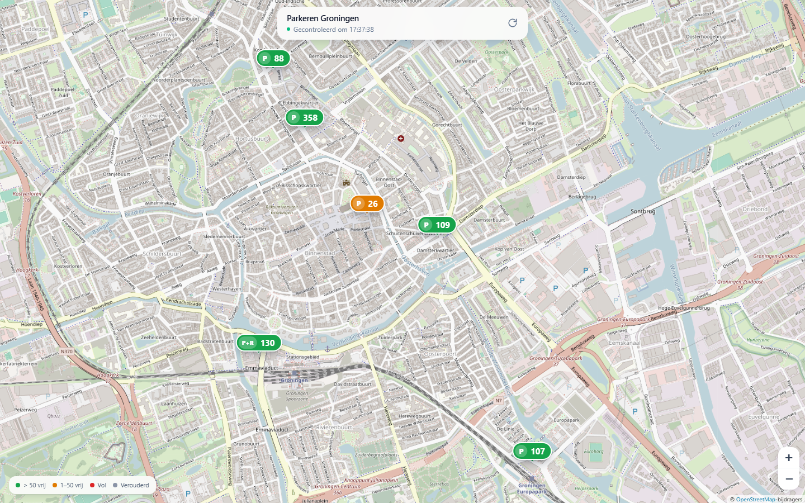
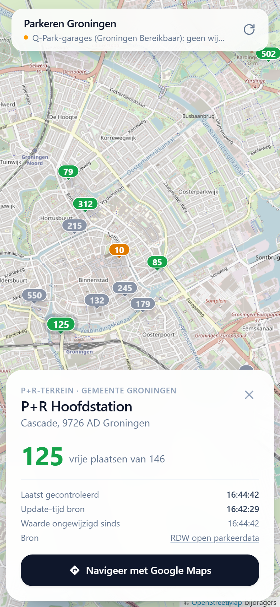

# Parkeren Live: vrije parkeerplaatsen in Nederland op de kaart

**Zie direct op de kaart waar je in Amsterdam, Rotterdam, Utrecht, Groningen en tientallen andere gemeenten nog kunt parkeren, en hoe actueel die informatie is.**

[](https://nodejs.org)
[](https://react.dev)
[](https://leafletjs.com)
[](#docker)
[](#databronnen)

Een lichte webapp die de **actuele parkeerbezetting in Nederland** toont: het aantal vrije plaatsen in parkeergarages, op parkeerterreinen en op P+R-terreinen, op één kaart. De kaart toont **alleen locaties met een live bezetting**. Bij de laatste test waren dat ongeveer 276 locaties in 63 gemeenten, waaronder:

- **Amsterdam** (34), **Rotterdam** (23), **Almere** (18), **Utrecht** (14), **Delft** (13), **Groningen** (12), **Nijmegen** (11), **Deventer** (9), **Alkmaar** (8), **Tilburg** (8) en vele kleinere.
- Elke stad heeft een eigen adres, zoals `/amsterdam` of `/groningen`. Via de naam in de header kies je een andere stad.

De kaart ververst automatisch. Per locatie zie je ook een trendanalyse: loopt de garage vol, en hoe druk is het normaal rond dit tijdstip? Er zijn geen accounts, geen advertenties en geen verzonnen cijfers. Alles komt uit open data.

<p align="center">
  
  &nbsp;
  
</p>

> **English:** Live map of available parking spaces in the Netherlands, with a page per city (Amsterdam, Rotterdam, Utrecht, Groningen and more). It shows only locations with live occupancy data: parking garages, car parks and park-and-ride (P+R) sites, with per-location trend analysis. Data comes from the national RDW open parking data, plus parkeren050.nl and Groningen Bereikbaar for Groningen. The app is built with React, Leaflet/OpenStreetMap and a dependency-free Node.js backend, and is ready for Docker.

---

## Wat je ziet

Elke marker toont direct het aantal vrije plaatsen. Je hoeft er niet op te klikken.

| Marker | Betekenis |
| --- | --- |
| 🟢 **Groen** | Meer dan 50 plaatsen vrij |
| 🟠 **Oranje** | 1 tot en met 50 plaatsen vrij |
| 🔴 **Rood** | Vol |
| ⚪ **Grijs met 🕒** | Laatst bekende waarde, mogelijk niet actueel |

- Een marker met **P** is een parkeergarage, een marker met **P+R** een P+R-terrein.
- Klik op een marker voor het informatievenster. Daarin staan het adres, de vrije plaatsen (met capaciteit als die bekend is), het tarief, de bron en de tijden. Er is ook een knop om te navigeren met Google Maps.
- In het informatievenster staat ook een **trendanalyse** per locatie, zie [Trendanalyse](#trendanalyse).
- Op `/` zie je heel Nederland. Ver uitgezoomd toont de kaart per stad één donkere **bundelmarker** met het aantal live locaties; klik erop om naar die stad te gaan.
- Op een stadspagina opent de kaart op de garages in het centrum. Zoom uit om de P+R-terreinen aan de rand te zien.
- De gegevens verversen **automatisch elke 60 seconden** zonder dat de pagina herlaadt, en direct wanneer je terugkeert naar het tabblad. Met de knop rechtsboven ververs je handmatig.
- Alle tijden staan in de tijdzone Europe/Amsterdam.

---

## Snel starten

Je hebt **Node.js 20 of hoger** nodig.

```bash
npm install
npm run dev
```

Open daarna <http://localhost:5173>. De API draait mee in de Vite-ontwikkelserver, dus je hebt één commando nodig.

### Productie

```bash
npm run build
npm start                    # http://localhost:3000
```

Wil je een andere poort? Gebruik dan `PORT=3050 npm start`. In PowerShell is dat `$env:PORT=3050; npm start`.

### Docker

```bash
docker build -t parkeren-live .
docker run -p 3000:3000 -v parkeren-data:/app/data parkeren-live
```

Het volume `parkeren-data` bewaart de historie voor de trendanalyse, ook bij updates van de container. Het image is meertraps opgebouwd. Het runtime-image bevat alleen `server/` en de gebouwde frontend, zonder `node_modules`. Een healthcheck draait op `/healthz`.

---

## Databronnen

Alle cijfers komen live uit openbare bronnen. Er is geen mock- of voorbeelddata. De kaart toont **alleen locaties waarvan de bron op dit moment een telling geeft**.

| Bron | Locaties | Update-tijd van de bron | Hoe actueel |
| --- | --- | --- | --- |
| [RDW open parkeerdata](https://npropendata.rdw.nl/parkingdata/v2/) | Alle openbare live-feeds in Nederland, ongeveer 225 locaties | ✓ | ✅ Live, met tijdstempel van de bron |
| [Technolution](https://opendata.technolution.nl/opendata/parkingdata/v1) (parkeerverwijssystemen van gemeenten, CC BY 4.0) | Ruim 40 extra locaties, onder andere Jaarbeurs en Hoog Catharijne in Utrecht, P+R-terreinen in Rotterdam, Tilburg, Alkmaar, Deventer, Veenendaal en de Groningse P+R-terreinen | ✓ | ✅ Live, met tijdstempel; de Groningse P+R-terreinen bijvoorbeeld tot op de seconde |
| [parkeren050.nl](https://www.parkeren050.nl/parkeren-groningen) | Groningen: gemeentelijke garages Forum, Damsterdiep, Boterdiep, Circus, Station Europapark | ✗ | ✅ Live, verandert van minuut tot minuut |
| [Groningen Bereikbaar](https://kaart.groningenbereikbaar.nl) | Groningen: P+R-terreinen, alleen als terugval (zie hieronder) | ✗ | 🟡 Ongeveer elke 16 minuten bijgewerkt |

### Hoe de data wordt opgehaald

- **RDW (SPDP v2)** is de landelijke open parkeerdata, met bijna 15.000 geregistreerde locaties. Daarvan hebben er zo'n 540 een live-feed; ongeveer 250 daarvan zijn openbaar en actueel. De server werkt zo:
  - de lijst en de vaste gegevens (naam, plek, capaciteit, exploitant) worden dagelijks ververst en bewaard in `data/rdw-facilities.json`;
  - de live stand wordt elke 2 minuten opgehaald (`RDW_POLL_SECONDS`), met 10 verzoeken tegelijk;
  - de gemeente per locatie komt van [PDOK](https://www.pdok.nl/introductie/-/article/pdok-locatieserver), zodat bijvoorbeeld "Almere Buiten" onder Almere valt;
  - **afgeschermde feeds** (HTTP 401, vrijwel allemaal Q-Park) worden 24 uur overgeslagen;
  - **dode feeds**, waarvan de bron al meer dan 24 uur niets heeft bijgewerkt, worden niet getoond.
- **parkeren050.nl** heeft geen API. De bezetting staat server-side in de HTML (`<p class="available-spaces">158 plaatsen vrij</p>` of `VOL`). Een kleine scraper leest de overzichtspagina. Daar komen ook de namen, adressen, tarieven en openingstijden vandaan.
- **Technolution** levert de parkeerverwijssystemen (de borden langs de weg) van veel gemeenten en publiceert die data in hetzelfde formaat (SPDP). Van de 181 feeds overlappen er veel met de landelijke data; ruim 40 locaties zijn nieuw. De data valt onder CC BY 4.0, daarom staat de bron met licentie in het informatievenster.
- **Ontdubbelen:** dezelfde plek kan in meerdere bronnen staan. Een locatie geldt als dubbel bij hetzelfde bron-id, bij minder dan 60 meter afstand, of binnen 300 meter met een gedeeld naamwoord ("Boterdiep"); de dichtstbijzijnde kandidaat wint. De volgorde van voorrang is: parkeren050.nl (met adres, tarief en openingstijden), landelijke open parkeerdata, Technolution, Groningen Bereikbaar. Neemt een bron met voorrang een locatie over, dan houdt die haar id (dus ook haar historie) en haar stad.
- **Gemeente:** PDOK bepaalt de gemeente op basis van de gemeentegrenzen. Terreinen op een grens, zoals P+R Hoogkerk 2 aan de A7, houden de stad van de stadsbron (Groningen).
- **Groningen Bereikbaar** gebruikt een openbare GeoJSON-API (`/api/maps/1.json`) achter de "Slimme Kaart". Die geeft per locatie de capaciteit en het aantal beschikbare plekken, maar geen tijdstempel.

### Bevindingen over de actualiteit

Gemeten op 10 oktober 2026. Van de 544 live-feeds in de RDW-data waren er 247 actueel (bijgewerkt in het laatste uur), 220 afgeschermd (HTTP 401), 72 al meer dan een dag niet bijgewerkt en 5 zonder telling of onbereikbaar. Voor Groningen:

- **P+R-terreinen (Groningen Bereikbaar):** de waarden veranderden om 12:30:50 en 12:46:55, dus ongeveer elke 16 minuten. Een getoonde waarde kan tot zo'n kwartier oud zijn.
- **Q-Park-garages (niet opgenomen):** Groningen Bereikbaar noemt ook vijf Q-Park-garages (Westerhaven, Museum Centrum, Rademarkt, Ossenmarkt, Oosterpoort). Hun waarden bleven van 12:22 tot minstens 17:27 exact gelijk, ruim vijf uur op een zaterdag in de binnenstad. Dezelfde bron meldde voor P+R Hoofdstation 146 van de 146 plaatsen vrij, terwijl de RDW tegelijkertijd 126 tot 128 vrij gaf. Deze cijfers zijn niet live, dus de app neemt ze niet op. De echte live-feed van Q-Park bij de RDW is afgeschermd (HTTP 401).
- **Zonder telling (niet getoond):** Euroborg en P+R Meerstad gaven tijdens het testen geen telling. Ze verschijnen automatisch zodra de bron er een aantal vrije plaatsen voor geeft.
- **Niet opgenomen:** UMCG, Martini Ziekenhuis, MartiniPlaza, Holland Casino en andere locaties. Daarvoor is geen openbare live bezetting gevonden.

---

## Hoe actueel is wat je ziet?

De app laat nooit onze eigen controletijd door voor de update-tijd van de bron. Per locatie toont het informatievenster:

| Veld | Betekenis |
| --- | --- |
| **Laatst gecontroleerd** | Wanneer onze server de stand voor het laatst met succes ophaalde |
| **Update-tijd bron** | De tijd die de bron zelf meegeeft (bij de landelijke open parkeerdata). Anders staat er "niet gepubliceerd door bron". |
| **Waarde ongewijzigd sinds** | Onze eigen waarneming van wanneer de waarde voor het laatst veranderde. Dit loopt via de historie ook over herstarts heen. "of eerder" betekent dat de waarde al zo was bij de eerste meting. |
| **Bron** | Link naar de herkomst van het cijfer |

Een marker wordt **grijs met een klokje** zodra één van deze dingen geldt:

1. de laatste geslaagde controle is ouder dan 5 minuten (`STALE_AFTER_SECONDS`);
2. de update-tijd van de bron is ouder dan 30 minuten (`SOURCE_STALE_AFTER_SECONDS`);
3. **de bron staat stil:** in een groep locaties zonder update-tijd van de bron is al 30 minuten geen enkele waarde veranderd (`FROZEN_AFTER_SECONDS`).

De stilstand-detectie is een vangnet voor bronnen die ongemerkt stoppen met bijwerken. Ze werkt per groep (bijvoorbeeld "P+R-terreinen (Groningen Bereikbaar)"), omdat binnen één bron het ene deel live kan zijn en het andere niet. Ze gebruikt de historie, dus ze werkt ook direct na een herstart.

Lukt het ophalen niet, dan blijft de laatst bekende waarde staan. De header en het informatievenster melden dan welke bron niet bereikbaar is.

---

## Trendanalyse

Per locatie toont het informatievenster een grafiek van de vrije plaatsen over **3 uur, 24 uur of 7 dagen**. Beweeg over de grafiek of tik erop voor de exacte waarde op een tijdstip. Erboven staat een korte analyse:

| Onderdeel | Hoe het wordt berekend |
| --- | --- |
| **Richting** (loopt vol, loopt leeg of stabiel) | Lineaire regressie over de metingen van het laatste halfuur. "Stabiel" betekent minder dan 6 plaatsen per uur, of minder dan 2% van de capaciteit. |
| **Tempo** | Dezelfde regressie, uitgedrukt in plaatsen per uur |
| **Vol rond …** | Alleen bij duidelijk vollopen, en alleen als de locatie bij dit tempo binnen 3 uur vol is. Dit is een schatting en wordt ook zo genoemd. |
| **Afgelopen uur** | Verschil tussen nu en 60 minuten geleden |
| **Normaal rond dit tijdstip** | Gemiddelde rond hetzelfde tijdstip (±30 min) op eerdere dagen. Verschijnt pas als er minstens 2 eerdere dagen met metingen zijn. |
| **Min, gemiddelde, max** | Over de gekozen periode |

### Waar de historie vandaan komt

- De server **meet zelf elke minuut** (`POLL_SECONDS`), ook als niemand de site bekijkt. De historie bevat dus geen gaten door gebrek aan bezoekers.
- Een meting wordt alleen opgeslagen als de waarde verandert, plus elke 5 minuten een controlepunt. Zo blijft het bestand klein.
- Er is geen database. De metingen staan in het geheugen en worden elke 5 minuten (en bij het afsluiten) weggeschreven naar `data/history.json` (`HISTORY_FILE`). Na een herstart gaat de historie verder waar hij was. Metingen ouder dan `HISTORY_DAYS` (standaard 7) worden opgeruimd.
- Mislukt het ophalen langer dan 12 minuten, dan zie je een **gat** in de lijn. De app vult niets in.
- De historie begint bij de eerste start van de server. Onder de grafiek staat "eigen metingen sinds …". De weergave van 7 dagen en "normaal rond dit tijdstip" worden dus pas na een paar dagen zinvol.

### Eerlijkheid

- Is de huidige stand niet actueel (verouderd, of uit een groep die stilstaat), dan geeft de app **geen richting, tempo of schatting**. De grafiek toont dan alleen de waarden zoals de bron ze meldde, met een melding erbij.
- Voor de P+R-terreinen uit Groningen Bereikbaar, die ongeveer elke 16 minuten worden bijgewerkt, is de richting over het laatste halfuur grover dan voor de live bronnen.

---

## Configuratie

Alle instellingen zijn omgevingsvariabelen van de server.

| Variabele | Standaard | Betekenis |
| --- | --- | --- |
| `PORT` | `3000` | Poort van de server |
| `THRESHOLD_LOW` | `50` | Groen boven deze waarde, oranje van 1 tot en met deze waarde, rood bij 0 |
| `CACHE_TTL_SECONDS` | `30` | Hoe lang een opgehaalde stand wordt hergebruikt |
| `FETCH_TIMEOUT_SECONDS` | `10` | Time-out per bron |
| `STALE_AFTER_SECONDS` | `300` | Verouderd als de laatste geslaagde controle ouder is dan dit |
| `SOURCE_STALE_AFTER_SECONDS` | `1800` | Verouderd als de update-tijd van de bron ouder is dan dit |
| `FROZEN_AFTER_SECONDS` | `1800` | Een groep zonder één enkele wijziging in deze tijd heet "mogelijk niet actueel" |
| `POLL_SECONDS` | `60` | Hoe vaak de server zelf meet, voor de historie |
| `HISTORY_DAYS` | `7` | Hoe lang de historie wordt bewaard |
| `HISTORY_FILE` | `data/history.json` | Bestand voor de historie. Leeg laten betekent alleen in het geheugen. De RDW-cache komt in dezelfde map. |
| `RDW_POLL_SECONDS` | `120` | Hoe vaak de landelijke feeds (landelijke open parkeerdata en Technolution) worden opgehaald |
| `SOURCE_URL` | `https://www.parkeren050.nl/parkeren-groningen` | Bronpagina van parkeren050.nl |

Twee instellingen gelden tijdens de build:

| Variabele | Standaard | Betekenis |
| --- | --- | --- |
| `VITE_TILE_URL` | OpenStreetMap-tegels | Eigen tegelserver |
| `VITE_TILE_ATTRIBUTION` | OpenStreetMap-bijdragers | Bronvermelding bij de kaart |

Voorbeeld:

```bash
docker run -p 3000:3000 -e THRESHOLD_LOW=30 parkeren-live
```

---

## Hoe het werkt

```
 Browser ──(elke 60 s)──▶ /api/parking ──▶ parking.js ◀──(elke 60 s)── eigen meting van de server
 Browser ──(bij openen)──▶ /api/history ─▶ history.js ──▶ data/history.json
                                             │  cache per bron (30 s), één ophaalactie tegelijk
                                             ├─▶ sources/parkeren050.js         HTML-scraper
                                             ├─▶ sources/rdw.js                 JSON
                                             └─▶ sources/groningenBereikbaar.js GeoJSON
```

- **Caching:** hoeveel bezoekers er ook zijn, elke bron wordt hooguit één keer per `CACHE_TTL_SECONDS` opgehaald. Gelijktijdige verzoeken delen één ophaalactie.
- **Fouttolerantie:** elke bron heeft een eigen cache, time-out en foutstatus. Valt één bron uit, dan blijven de andere werken.
- **Minimale dependencies:** de server gebruikt alleen ingebouwde Node-modules. De frontend gebruikt React, Leaflet en Tailwind CSS.

### Projectstructuur

```
server/
  index.js                    productieserver: API en statische bestanden
  parking.js                  combineert de bronnen: cache, versheid, stilstand-detectie, eigen metingen
  history.js                  historie (JSON-bestand) en trendanalyse
  config.js                   instellingen en fetch met time-out
  sources/
    parkeren050.js            gemeentelijke garages (scraper)
    spdp.js                   gedeelde code voor SPDP-feeds: vaste gegevens, gemeente (PDOK), live stand
    rdw.js                    landelijke open parkeerdata (SPDP)
    technolution.js           parkeerverwijssystemen van gemeenten (SPDP, CC BY 4.0)
    groningenBereikbaar.js    P+R-terreinen
src/
  App.jsx                     verversen, foutafhandeling, klokcorrectie
  ParkingMap.jsx              Leaflet-kaart en markers
  Header.jsx                  zwevende header met verversstatus
  GarageCard.jsx              informatievenster
  TrendPanel.jsx              trendanalyse en grafiek
  Legend.jsx                  legenda
  lib.js                      kleuren, versheid, tijdnotatie
```

### API

`GET /api/parking` geeft alle locaties met een live telling terug, met hun bronnen en versheid:

```jsonc
{
  "serverTime": "2026-10-10T14:44:42.000Z",
  "thresholds": { "low": 50 },
  "sources":   [{ "id": "rdw", "name": "Landelijke open parkeerdata", "lastSuccessAt": "…", "error": null }],
  "groups":    [{ "id": "groningen-bereikbaar:pr:Gemeente Groningen", "label": "P+R-terreinen (Groningen Bereikbaar)", "frozen": false }],
  "cities":    [{ "slug": "amsterdam", "name": "Amsterdam", "count": 34, "free": 5210, "lat": 52.36, "lng": 4.9 }],
  "locations": [{
    "id": "pr-hoofdstation", "name": "P+R Hoofdstation", "kind": "pr",   // kind: garage | pr | lot
    "city": "Groningen", "citySlug": "groningen",
    "lat": 53.211582, "lng": 6.560898,
    "free": 125, "capacity": 146, "status": "available",
    "lastCheckedAt": "…", "sourceUpdatedAt": "…", "valueSince": "…"
  }]
}
```

`GET /api/history?id=<locatie>&range=3h|24h|7d` geeft de trendanalyse van één locatie terug:

```jsonc
{
  "id": "damsterdiep", "range": "3h", "reliable": true,
  "historySince": "…", "samples": 36,
  "points": [["2026-10-10T13:50:00.000Z", 96], ["…", null]],   // null = gat
  "stats": { "min": 44, "avg": 85, "max": 137 },
  "current": 79, "change15": -13, "change60": -13,
  "ratePerHour": -17, "direction": "filling",                  // filling | emptying | stable
  "fullAt": null,                                              // schatting, alleen binnen 3 uur
  "typical": { "value": 146, "days": 7 }                       // null bij minder dan 2 dagen
}
```

---

## Bekende beperkingen

- **Alleen live locaties:** garages zonder openbare live bezetting, zoals Q-Park, UMCG en Martini Ziekenhuis, staan niet op de kaart (zie [Bevindingen over de actualiteit](#bevindingen-over-de-actualiteit)).
- **Scraper:** als parkeren050.nl de opbouw van de pagina wijzigt, kan het uitlezen stoppen. De header meldt dan "parkeren050.nl niet bereikbaar" en het informatievenster noemt de oorzaak ("geen garages gevonden in de bron"). De laatst bekende waarden blijven staan en worden na 5 minuten als verouderd gemarkeerd.
- **Kaarttegels:** de standaard OpenStreetMap-tegelserver is bedoeld voor licht gebruik. Gebruik bij veel bezoekers een eigen of commerciële tegelserver via `VITE_TILE_URL`.
- **Euroborg en P+R Meerstad:** de bronnen gaven tijdens het testen geen telling, dus ze staan niet op de kaart. Ze verschijnen automatisch zodra de bron een telling geeft.

---

## Licentie

Copyright (C) 2026 ProAdmin007

De broncode valt onder de [GNU Affero General Public License v3.0](LICENSE) (AGPL-3.0). Je mag de code gebruiken, aanpassen en verspreiden. Bied je een aangepaste versie aan als website of online dienst, dan moet je de broncode van die versie ook openbaar maken onder dezelfde licentie. Daarom staat er rechtsonder op de kaart een link "Broncode".

De licentie geldt alleen voor de code, niet voor de parkeerdata. Daarvoor gelden de voorwaarden van de bronnen zelf:

- **Landelijke open parkeerdata:** CC0. Volgens de bijsluiter mag bij hergebruik niet worden vermeld van welke overheidsdienst de data afkomstig is.
- **Technolution (parkeerverwijssystemen van gemeenten):** CC BY 4.0, met naamsvermelding.
- **Kaartgegevens:** © OpenStreetMap-bijdragers (ODbL).
